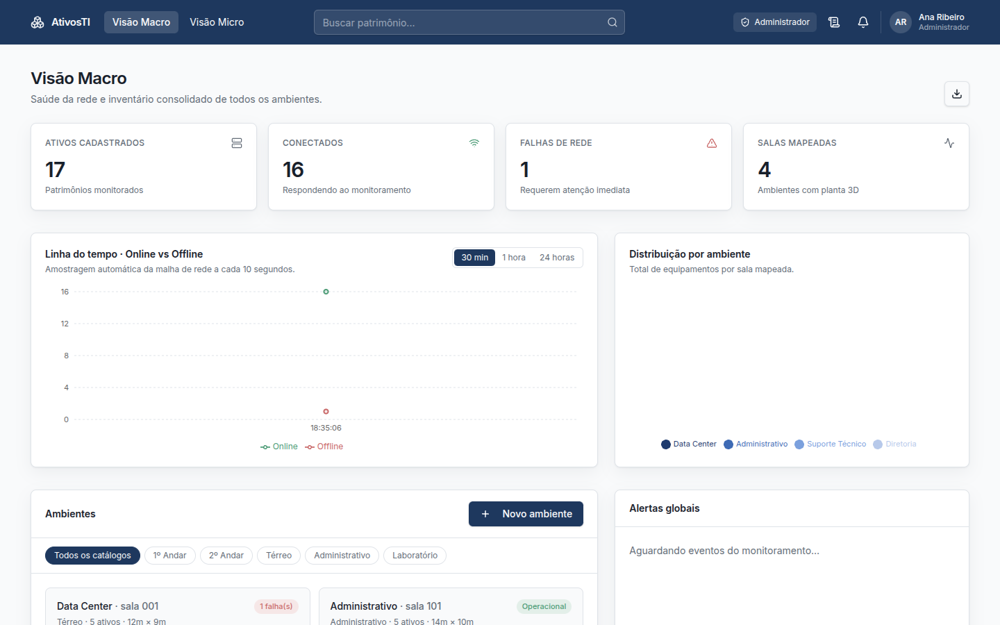
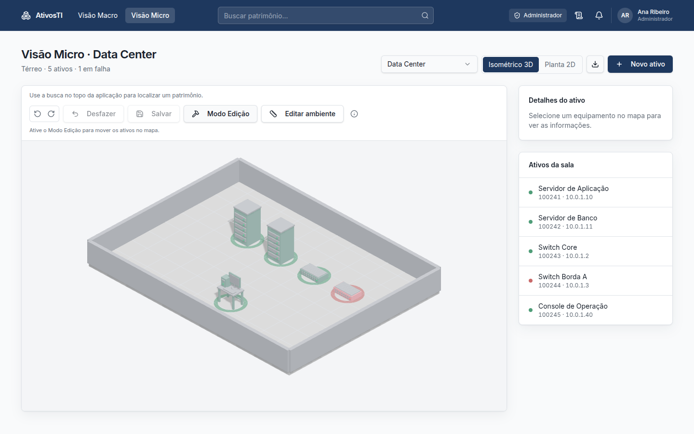
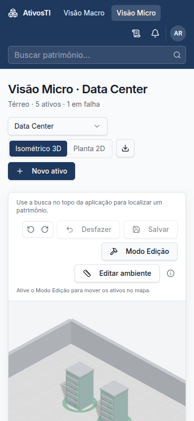

# AtivosTI

Inventário de ativos de TI com a planta do ambiente. O sistema mostra **onde** cada patrimônio está, **quem** pode mexer nele e **se** a rede simulada o considera online.

Protótipo de Trabalho de Conclusão de Curso: uma operação de TI deixa de depender só de planilha e passa a enxergar o parque em duas escalas, a da empresa inteira e a da sala.

<p align="center">
  
</p>

<p align="center">
  
</p>

## Sumário

- [O problema](#o-problema)
- [O que o sistema faz](#o-que-o-sistema-faz)
- [Telas](#telas)
- [Papéis e permissões](#papéis-e-permissões)
- [Onde cada dado fica](#onde-cada-dado-fica)
- [Como rodar](#como-rodar)
- [Mapa do código](#mapa-do-código)
- [Modelo](#modelo)
- [Inventário inicial](#inventário-inicial)
- [Escopo do protótipo](#escopo-do-protótipo)
- [Stack](#stack)

## O problema

Uma planilha de patrimônio responde o código, o IP e o responsável. Ela não responde em qual célula da sala o switch está, nem deixa um visualizador achar o equipamento sem abrir o mapa na mão.

O AtivosTI junta três coisas no mesmo lugar:

1. O cadastro do patrimônio (código, nome, tipo e IP).
2. A posição dele numa grade de 1 m, dentro de uma sala com largura e profundidade reais.
3. Um status de rede, online ou offline, desenhado no próprio equipamento.

A Visão Macro olha a empresa. A Visão Micro entra na sala.

## O que o sistema faz

| Área | Comportamento |
| --- | --- |
| Mapa 3D | Planta isométrica da sala. O anel verde ou vermelho acompanha o status. |
| Planta 2D | A mesma grade em SVG. Arrastar vale nos dois modos. |
| Grade | Células de 1 m, com o ativo no centro (`*.5`). Célula ocupada é recusada. |
| Mover | Com a permissão e o Modo Edição ligados, o arraste grava a nova posição neste navegador. |
| Transferir | Botão direito no equipamento abre transferir, editar ou excluir. A sala nova também fica gravada. |
| Desfazer | `Ctrl+Z` desfaz a última ação da sessão. A posição desfeita é a que permanece gravada. |
| Busca | Patrimônio, nome ou IP no topo. A sala abre e o equipamento é centralizado. |
| Monitoramento | A cada 6 s um ativo pode trocar de status. Dá para desligar em Configurações. |
| Alertas | Sininho para queda e reconexão, com atalho até o ativo. Toque e volume configuráveis. |
| Relatórios | CSV e PDF da Visão Macro, respeitando o catálogo e os filtros da tela. |
| Histórico | Ações de usuário e eventos de rede, com exportação da aba que está aberta. |
| Gráficos | Linha do tempo online/offline, nas janelas de 30 min, 1 h e 24 h, e a distribuição por sala. |
| Aparência | Tema claro ou escuro, cores de online/offline e o ritmo da amostragem (10 s, 30 s ou 1 min). |

Um clique sem arrastar só seleciona. A mudança de lugar acontece no arraste, ou na confirmação da transferência.

<p align="center">
  
</p>

## Telas

| Rota | Quem entra | O que encontra |
| --- | --- | --- |
| `/auth` | Público | Entrar ou cadastrar com e-mail e senha. |
| `/` | Autenticado | Visão Macro: indicadores, gráficos, catálogos e inventário. |
| `/salas/$salaId` | Autenticado | Visão Micro da sala, em 3D ou 2D. |
| `/logs` | Autenticado | Histórico de ações e de eventos de rede. |
| `/admin` | Administrador | Cargos e as quatro permissões de cada usuário. |

As rotas autenticadas nascem de arquivos em `src/routes`. A convenção de nomes está em [`src/routes/README.md`](src/routes/README.md).

### Um passeio curto

1. Cadastre-se. A primeira conta do projeto vira administradora. As seguintes entram como visualizador.
2. Na Visão Macro, filtre por catálogo (Térreo, Administrativo, 1º Andar, 2º Andar, Laboratório) e abra uma sala.
3. Na Visão Micro, ligue o Modo Edição e arraste um ativo, ou use o botão direito para mandá-lo a outra sala.
4. Atualize a página. A posição e a sala continuam neste navegador.
5. Busque `400588` para cair no Notebook Diretoria.

O botão **Salvar** encerra a fila de desfazer da sessão. A posição já foi gravada no arraste ou na transferência.

## Papéis e permissões

O cargo mora no Supabase, na tabela `user_roles`, com o enum `app_role`:

| Cargo | No dia a dia |
| --- | --- |
| `admin` | Cria e redimensiona salas, abre o painel de usuários e, por padrão, pode mover, editar, excluir e transferir. |
| `viewer` | Consulta o mapa e o inventário. Só altera o que o administrador marcar. |

As quatro permissões finas são **mover**, **editar**, **excluir** e **transferir**. O administrador marca isso em `/admin`. Elas ficam neste navegador (`ativosti.permissoes`), então o mesmo usuário em outro computador ainda não herda essas marcas.

Criar ambiente e **Editar ambiente** seguem o cargo de administrador.

O gatilho `handle_new_user` cria o perfil e entrega `admin` só quando ainda não existe nenhum papel. A migration `supabase/migrations/20261028180000_first_admin_lock.sql` serializa esse primeiro cadastro com `pg_advisory_xact_lock`, para dois registros simultâneos não virarem os dois administradores.

## Onde cada dado fica

| Dado | Onde vive | Sobrevive a atualizar a página? |
| --- | --- | --- |
| Conta, sessão, nome e cargo | Supabase Auth, `profiles`, `user_roles` | Sim, em qualquer navegador |
| Salas, patrimônios, posições e transferências | `localStorage` (`ativosti.inventario`) | Sim, neste navegador |
| Histórico de ações | `localStorage` (`ativosti.historico`) | Sim, neste navegador |
| Permissões finas | `localStorage` (`ativosti.permissoes`) | Sim, neste navegador |
| Tema, som, cores e tutorial | `localStorage` (`ativosti.settings`) | Sim, neste navegador |
| Fila de desfazer (`Ctrl+Z`) | Memória da aba | Não |
| Eventos de status da simulação | Memória da aba. O status atual do ativo vai junto do inventário | O status do patrimônio permanece; a lista de eventos de rede recomeça |

Enquanto não existe inventário gravado, o sistema abre a semente de demonstração descrita [abaixo](#inventário-inicial).

## Como rodar

### Pré-requisitos

- Node.js 20.19 ou superior
- npm
- Um projeto [Supabase](https://supabase.com) com as migrations deste repositório aplicadas

### 1. Clonar e instalar

```sh
git clone https://github.com/JoaoMGDev/sist-monit-ativos-3D.git
cd sist-monit-ativos-3D
npm install
```

### 2. Variáveis de ambiente

Crie um `.env` na raiz. O cliente usa a URL e a chave publicável; no servidor as mesmas informações também são lidas sem o prefixo `VITE_`.

```sh
VITE_SUPABASE_URL="https://SEU-PROJETO.supabase.co"
VITE_SUPABASE_PUBLISHABLE_KEY="sua-chave-publicavel"
VITE_SUPABASE_PROJECT_ID="seu-project-id"

SUPABASE_URL="https://SEU-PROJETO.supabase.co"
SUPABASE_PUBLISHABLE_KEY="sua-chave-publicavel"
SUPABASE_PROJECT_ID="seu-project-id"
```

A chave de service role (`SUPABASE_SERVICE_ROLE_KEY`) só entra em operação de servidor que precise ignorar o RLS. Não coloque essa chave no frontend e não a commite.

### 3. Banco

Aplique os arquivos de `supabase/migrations/`, na ordem do nome. Eles criam `profiles` e `user_roles`, restringem a leitura ao próprio usuário ou a um administrador, e travam o primeiro cadastro para que só uma conta receba o cargo `admin`.

No SQL Editor do Supabase, ou com a CLI apontando para o projeto:

```sh
supabase db push
```

Se a confirmação de e-mail estiver ligada em Authentication, a conta nova só entra depois do link enviado para a caixa de entrada.

### 4. Subir

```sh
npm run dev
```

Abra [http://localhost:5173](http://localhost:5173). O app redireciona para `/auth`.

### Scripts

| Comando | Efeito |
| --- | --- |
| `npm run dev` | Servidor de desenvolvimento Vite. |
| `npm run build` | Build de produção. |
| `npm run build:dev` | Build no modo development. |
| `npm run preview` | Serve o build localmente. |
| `npm run lint` | ESLint. |
| `npm run format` | Prettier no repositório. |

## Mapa do código

```text
src/
  routes/                 páginas (TanStack Start, rota por arquivo)
    auth.tsx              entrada e cadastro
    _authenticated/       área logada
      index.tsx           Visão Macro
      salas.$salaId.tsx   Visão Micro
      logs.tsx            histórico
      admin.tsx           usuários e permissões
  components/
    IsometricRoom.tsx     sala 3D (Three.js)
    FloorPlan2D.tsx       planta SVG
    AppShell.tsx          topo, busca, alertas
    AnalyticsCharts.tsx   linha do tempo e distribuição
  lib/
    asset-store.ts        salas, patrimônios, grade e máscara de IP
    auth.ts               sessão e perfil
    permissions.ts        mover, editar, excluir, transferir
    history.ts            auditoria de ações
    report.ts             CSV e PDF
    settings.ts           tema, som e simulação
supabase/migrations/      perfil, papéis e RLS
```

O monitoramento não abre socket de verdade. `connectMonitoring` publica, a cada 6 segundos, um evento para quem estiver inscrito. A interface reage sem recarregar a página.

## Modelo

**No navegador**

- `Sala`: nome, número, catálogo, largura e profundidade em metros.
- `Patrimonio`: código numérico, nome, tipo (`desktop`, `notebook`, `servidor`, `switch`, `impressora`), IP, sala, coordenadas `x`/`z` e status.

O IP é mascarado enquanto a pessoa digita: os pontos permanecem e cada octeto para em 255.

**No Supabase**

- `profiles`: nome e e-mail, um para cada usuário do Auth.
- `user_roles`: `admin` ou `viewer`.
- `has_role`: usada pelas políticas de RLS para a administração de papéis.

## Inventário inicial

Quatro salas e 17 patrimônios, até que este navegador grave o seu próprio mapa.

| Sala | Número | Catálogo | Piso |
| --- | --- | --- | --- |
| Data Center | 001 | Térreo | 12 m × 9 m |
| Administrativo | 101 | Administrativo | 14 m × 10 m |
| Suporte Técnico | 102 | 1º Andar | 11 m × 8 m |
| Diretoria | 201 | 2º Andar | 10 m × 8 m |

O catálogo Laboratório começa sem ambiente. Ele existe para o filtro e para uma sala nova.

Alguns códigos úteis na demonstração: `100241` (Servidor de Aplicação, Data Center), `100245` (Console de Operação) e `400588` (Notebook Diretoria).

## Escopo do protótipo

O monitoramento representa a malha. Ele não faz ping, SNMP nem consulta um agente instalado na máquina.

O mapa, as permissões finas e o histórico de ações acompanham o navegador em que foram gravados. Outro computador abre a semente de novo, com a mesma conta.

A fila de desfazer vale enquanto a aba está aberta. Atualizar a página mantém a posição e o registro da ação, e encerra o `Ctrl+Z` daquela sessão.

## Stack

| Camada | Escolha |
| --- | --- |
| Interface | React 19, TypeScript |
| App | TanStack Start e TanStack Router |
| Estilo | Tailwind CSS 4, Radix UI |
| Mapa 3D | Three.js |
| Gráficos | Recharts |
| Conta e papéis | Supabase Auth, Postgres e RLS |
| Build | Vite 8 |

O repositório está ligado ao [Lovable](https://lovable.dev). Um push na branch conectada volta para o editor, então a branch precisa continuar instalando e abrindo.
